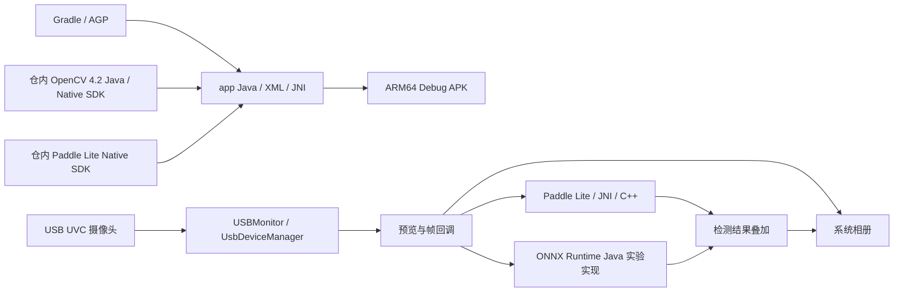

# DoctorCam

DoctorCam 是个人维护的原生 Android 摄像头与端侧视觉实验项目，使用 Java、AndroidX、USB UVC、OpenCV、ONNX Runtime 和 Paddle Lite / JNI。源码实现了设备枚举、预览、抓拍、检测结果叠加及图片保存；当前仍是原型工程，不代表已完成商店发布、设备兼容性或医疗用途验证。

## 当前能力

- 通过 USBMonitor 枚举设备、监听插拔并申请 USB 访问权限；点击设备进入 UVC 预览，支持抓拍保存。
- 长按设备进入 Paddle Lite 检测页：摄像头帧经图像转换、JNI / C++ 推理、检测框绘制后可保存到相册。
- 保留 ONNX Runtime Java 检测实现，包含 320 × 320 letterbox 预处理、置信度筛选、NMS 与坐标还原；当前列表中的 ONNX 跳转被注释，不是默认可选入口。
- 包内提供 ONNX / Paddle 模型资源；图像写入系统相册，当前未实现账号、后端 API 或数据库服务。

上述能力按现有源码描述。历史图表、论文材料和源码中的参数不构成性能、准确率、临床效果或本次实机验证结果。

## 架构拓扑



## 开发入口

仓库根就是 Android Gradle 工程根，应用模块为 `app`，安装身份保持 `cn.darrenyou.doctorcam`。准备 JDK、SDK 35、NDK 17.2.4988734 与 CMake 3.22.1 后，可构建本地 ARM64 验证包，完整准备与运行命令见[开发与验证说明](docs/operations/android-app/development.md)。

```bash
./gradlew --version
./gradlew --no-daemon -Pandroid.builder.sdkDownload=false help
./gradlew --no-daemon -Pandroid.builder.sdkDownload=false :app:assembleDebug
```

APK 输出为 `app/build/outputs/apk/debug/app-debug.apk`。应用需要真实 USB UVC 摄像头；ARM64 模拟器可用于启动、Native 加载及模型回归，未连接 USB 摄像头时设备列表显示“暂无设备”。

## 文档与治理

- [应用模块说明](app/README.md)
- [文档索引](docs/README.md)
- [Android 架构与实现边界](docs/design/android-app/architecture.md)
- [开发、构建与发布边界](docs/operations/android-app/development.md)
- [仓库元数据](repo-meta.yaml)；[AI 协作规则](AGENTS.md)
- [darren-space Android 工程标准](https://github.com/darren-you/darren-space/blob/master/harness/docs/workspace/standards/android-app/android-app-golden-path.md)
- [统一应用版本标准](https://github.com/darren-you/darren-space/blob/master/harness/docs/workspace/standards/client-version-golden-path.md)

工作区逻辑身份为 `doctor-cam`，归属 `work-personal`，真实技术域与交付面均为 `android-app`。`lifecycle: incubating` 表达实验原型状态，不表示 Android 工程标准已经通过。当前没有 Fast Deploy Job、Core 子模块或正式发布入口；元数据中的 `release-android-app` 只标识该交付面的标准工作流方向。后续发布接入须单独完成构建、版本、签名及设备验证。
