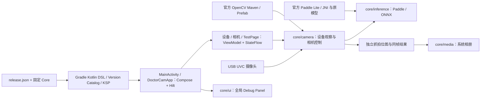

# DoctorCam

DoctorCam 是个人维护的 Android USB UVC 摄像头与端侧视觉实验项目。应用使用 Kotlin、Jetpack Compose、Material 3、类型安全 Navigation Compose、Hilt 与协程 / StateFlow；OpenCV、Paddle Lite / JNI 和 ONNX Runtime 承载图像转换与推理。项目仍处于原型阶段，不代表已完成商店发布、摄像头兼容性或医疗用途验证。

## 当前能力

- 设备列表观察 Android USB 插拔与视频设备；轻点设备进入 UVC 预览，长按进入 Paddle 检测。
- 相机页按真实设备 ID、VID、PID 申请和消费 USB 权限，显示预览、检测框与连接状态，并抓拍保存到系统相册。
- Paddle 使用包内既有模型和标签，通过 JNI 执行推理；ONNX 保留为内部推理引擎，没有公开的设备列表入口。
- Compose 单 Activity 装配页面与 ViewModel，TextureView 承载 UVC Surface，Compose Canvas 绘制同一帧的检测结果。
- 开发模式的全局 Debug Panel 默认展开，支持拖动、折叠和进入类型安全 TestPage；Release 编译检查唯一 `_debug` 开关，正式界面不显示调试入口。

模型文件、历史论文和合成图像回归不提供医学准确率、检测性能或真实摄像头验收证据。

## 架构拓扑



## 开发入口

仓根是唯一 Android Gradle 工程根，应用模块为 `app`，安装身份为 `com.silicicsoft.doctorcam`。准备 JDK 21、正式 SDK 37.2 / Build Tools 37.0.0、NDK 30.0.16248370 与 CMake 4.1.2，物化仓内固定的 `fast-deploy` 子模块后构建本地 ARM64 验证包。AGP 9 使用内置 Kotlin，三方版本由 Version Catalog 固定；UVCAndroid 1.0.13、OpenCV 与 ONNX Runtime 从 Maven Central 获取，Paddle Lite 由本仓脚本校验官方制品后准备到构建目录；仓库不保留旧 SDK 副本。完整步骤见[开发与验证说明](docs/operations/android-app/development.md)。

```bash
git submodule update --init fast-deploy
./gradlew --version
./gradlew --no-daemon -Pandroid.builder.sdkDownload=false :app:assembleDebug
./gradlew --no-daemon -Pandroid.builder.sdkDownload=false :app:assembleDebugAndroidTest
```

Debug APK 位于 `app/build/outputs/apk/debug/app-debug.apk`，Android 8.0 / API 26 及以上可安装。ARM64 模拟器或未接入 UVC 摄像头的真机可验证启动、页面交互、Native 与模型执行；设备列表显示“暂无设备”。实际预览、抓拍、USB 授权与拔插必须连接真实 UVC 摄像头验收。

## 文档与治理

- [应用模块说明](app/README.md)
- [文档索引](docs/README.md)
- [Android 架构与实现边界](docs/design/android-app/architecture.md)
- [开发、构建与发布边界](docs/operations/android-app/development.md)
- [仓库元数据](repo-meta.yaml)；[AI 协作规则](AGENTS.md)
- [Android 工程标准](https://github.com/darren-you/darren-space/blob/master/harness/docs/workspace/standards/android-app/android-app-golden-path.md)
- [统一应用版本标准](https://github.com/darren-you/darren-space/blob/master/harness/docs/workspace/standards/client-version-golden-path.md)

工作区逻辑身份为 `doctor-cam`，归属 `work-personal`。`release.json` 只声明初始／最低目标版本 `1.0.0`；Gradle 通过仓内固定 Core 消费本地验证输入或 Core 正式版本快照。本地 APK 使用验证编号 `1` 并标记 `client_local_validation=true`，不能正式分发。

正式发布入口为 Fast Deploy 的 `doctor-cam-android-app`，由仓根 [deploy_config.sh](deploy_config.sh) 绑定生产 `official / apk` 渠道，在 `mac-ci-1` 构建。Release 通过同一 Debug 静态门禁、固定 Profile 的 PKCS12 签名、最终证书回读和全库 16 KiB 检查；构建不修改 Git。发布合同见[开发说明](docs/operations/android-app/development.md#正式发布)。发布配置接入与本地运行不代表正式编号、正式 APK 或 GitHub Release 已验收；运行证据与本次发布结果统一记录在[工作区 Issue 72](https://github.com/darren-you/darren-space/issues/72)。
