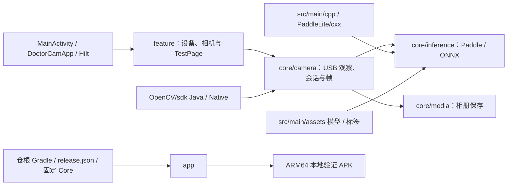

# DoctorCam Android 应用模块

本目录由仓根 Gradle Kotlin DSL 装配，不是独立 Gradle 根。构建、工具链、运行命令与发布边界统一见[开发与验证说明](../docs/operations/android-app/development.md)。

## 架构拓扑

| 路径 | 职责 |
| --- | --- |
| `src/main/java/cn/darrenyou/doctorcam/` | Kotlin Application、单 Activity 与 Compose 组合根 |
| `src/main/java/cn/darrenyou/doctorcam/feature/` | 设备列表、相机页面、ViewModel 与类型安全路由；TestPage |
| `src/main/java/cn/darrenyou/doctorcam/core/camera/` | USB 视频设备观察、精确设备授权、相机会话与独立抓拍帧 |
| `src/main/java/cn/darrenyou/doctorcam/core/inference/` | 推理接口、Paddle / ONNX 引擎、检测结果与工厂 |
| `src/main/java/cn/darrenyou/doctorcam/core/media/` | 同帧检测结果绘制、系统相册写入及保存结果 |
| `src/main/java/cn/darrenyou/doctorcam/core/ui/`、`ui/theme/` | 全局 Debug Panel 与 Material 3 系统主题 |
| `src/main/java/cn/darrenyou/doctorcam/paddle/`、`utils/` | Java JNI 与 OpenCV 图像转换边界 |
| `src/main/cpp/` | Paddle Lite JNI、C++ 图像预处理与推理后处理 |
| `src/main/assets/` | 原 ONNX / Paddle 模型与 Paddle 标签 |
| `src/main/res/` | Android 图标、系统主题与平台资源 |
| `OpenCV/sdk/` | OpenCV 4.2.0 Java / Native SDK，装配为 `:opencv` |
| `PaddleLite/cxx/` | 既有 Paddle Lite 头文件与 ARM64 预编译库 |
| `src/test/`、`src/androidTest/` | JVM 检查、真实 Compose UI 与 Native / 推理引擎回归 |
| `src/testFixtures/`、仓根 `tool/` | 唯一 `_debug` 字面量的 Release 门禁与 fixture |

设备轻点预览、长按 Paddle 检测；ONNX 通过内部推理接口保留，没有公开选择入口。原 Activity / Fragment、ViewBinding XML 页面与 XML 导航已由 Compose 页面和类型安全路由替代，源码职责与生命周期见[架构说明](../docs/design/android-app/architecture.md)。

本项目没有业务数据库、账号或后端 API。Hilt 直接装配摄像头、推理与相册依赖，页面使用 ViewModel / StateFlow；母版的 Room 启动统计、主题设置持久化与 Platform Infra Storage 示例不进入本应用。Material 3 主题跟随系统，Android 12 及以上使用动态颜色。

版本从仓根 `release.json` 经固定 Core 读取，Debug 与 Release 构建使用同一安装身份。Release 必须先将 [DoctorCamApp.kt](src/main/java/cn/darrenyou/doctorcam/DoctorCamApp.kt) 中唯一 `_debug` 改为 `false` 并通过门禁；正式发布配置与签名渠道仍需单独接入。
