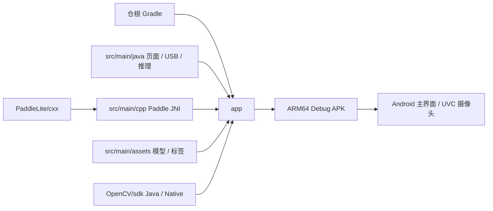

# DoctorCam Android 应用模块

本目录由仓根 Gradle 工程装配，不是独立 Gradle 根。构建从仓根执行，工具链、运行命令和发布边界统一见[开发与验证说明](../docs/operations/android-app/development.md)。

## 架构拓扑

| 路径 | 职责 |
| --- | --- |
| `src/main/java/cn/darrenyou/doctorcam/` | Activity、Fragment、UVC 设备管理、Java 推理及图像工具 |
| `src/main/cpp/` | Paddle Lite JNI 接口及 C++ 预处理、推理、后处理 |
| `src/main/assets/` | ONNX 模型、Paddle 模型与标签 |
| `src/main/res/` | ViewBinding 布局、导航和 Android 资源 |
| `OpenCV/sdk/` | OpenCV 4.2.0 Java 绑定与 Native SDK，同版本装配为 `:opencv` |
| `PaddleLite/cxx/` | 仓内现有 Paddle Lite 头文件与预编译库 |
| `src/test/`、`src/androidTest/` | JVM 测试与 Android Native / 模型回归；真实 UVC 帧仍需摄像头验收 |

普通预览和 Paddle 检测入口位于设备列表页；ONNX 页面存在源码与导航声明，但当前列表跳转被注释。[架构说明](../docs/design/android-app/architecture.md)给出各链路的真实实现边界。

工程标准入口：[Android 工程标准](https://github.com/darren-you/darren-space/blob/master/harness/docs/workspace/standards/android-app/android-app-golden-path.md)。本地构建使用既有应用身份、Java / XML 界面与模型；标准发布入口尚未接入。
